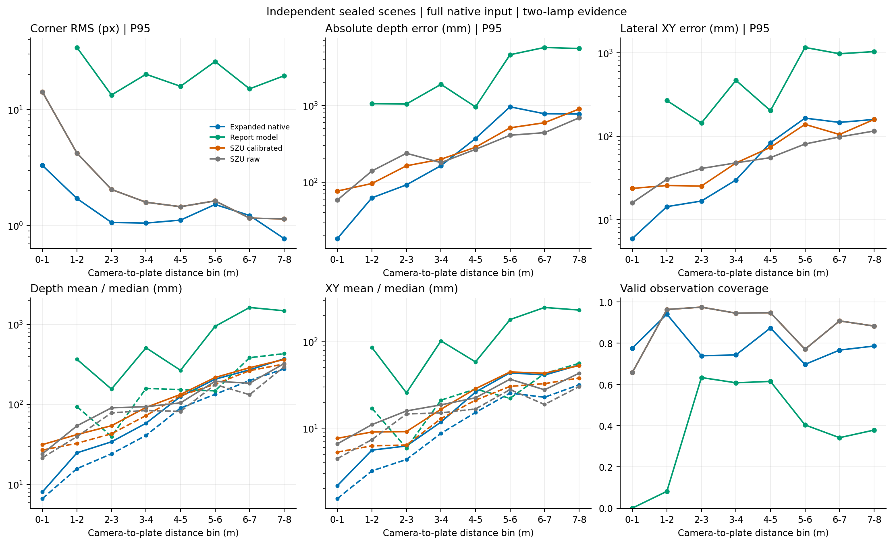
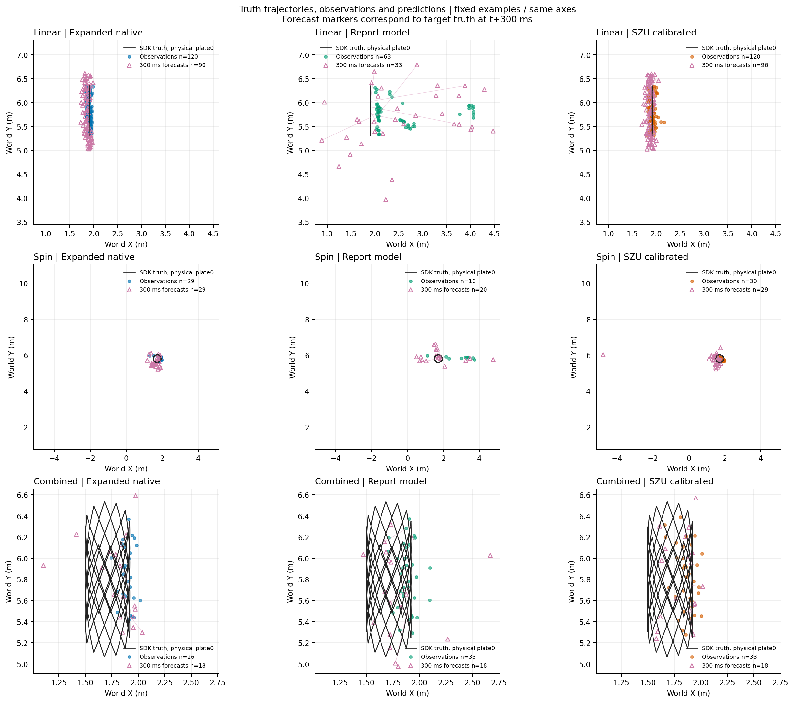
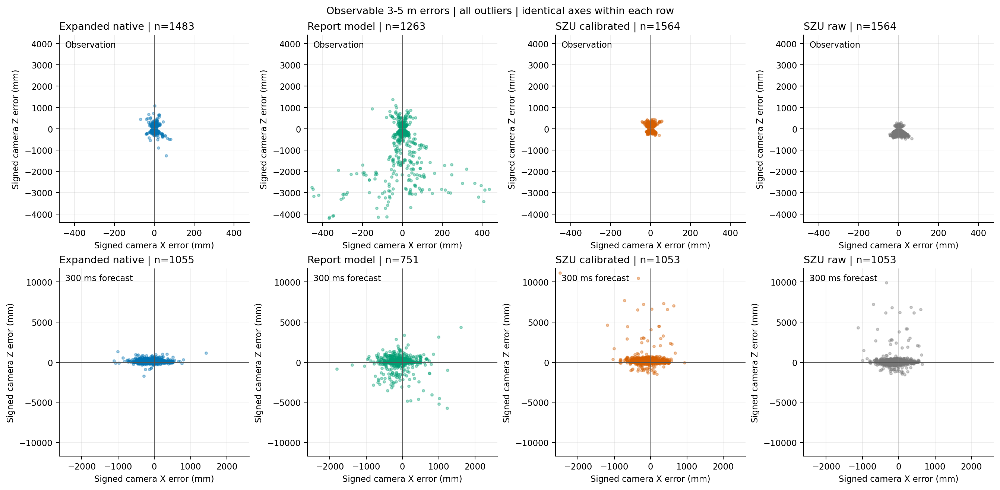
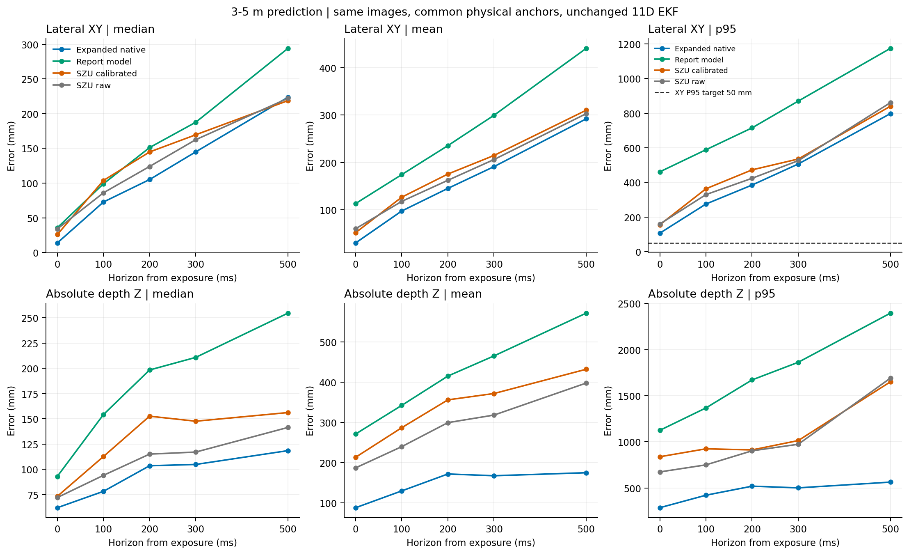
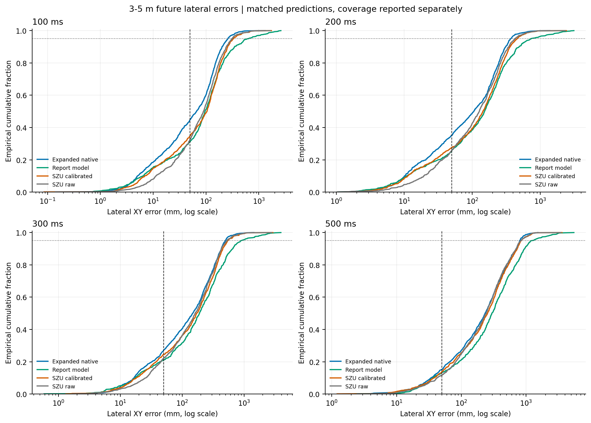

# 零roll扩展版：评价口径与实际能力

**原报告精度保持通过；扩展域与未来预测目标尚未全面达到。** 本版不能概括为所有场景优于深大。

[完整JSON](results/roll0-v2/metrics.json) · [分距离CSV](results/roll0-v2/distance-errors.csv) · [分场景单帧CSV](results/roll0-v2/single-frame-by-condition.csv) · [分场景预测CSV](results/roll0-v2/prediction-by-condition.csv) · [实际数据覆盖](results/roll0-v2/dataset-card.json) · [原报告历史结果](docs/EVALUATION_REPORT_V1.md)

## 1. 原报告回归：同一双灯条支持总体

该1080帧数据已用于开发回归，不当作未见测试。3–5m沿用原报告光轴Z定义；全部方法按同一独立两灯条图像证据总体评分。预先设置的描述性精度保留阈值为每项P95不超过原版1.1倍、覆盖不低于90%且最多损失2百分点，不是统计学非劣效检验。

| 方法 | 有效/应评 | 角点P95 px | 深度 均值/中位/P95 cm | 横向 均值/中位/P95 cm |
| --- | ---: | ---: | ---: | ---: |
| 本次零roll模型 | 490/497 | 0.239 | 2.523 / 1.920 / 6.587 | 0.371 / 0.286 / 0.936 |
| 原报告模型 | 497/497 | 0.240 | 2.526 / 1.976 / 6.900 | 0.365 / 0.280 / 0.941 |
| 深大原始 | 497/497 | 1.128 | 22.036 / 21.559 / 36.554 | 2.977 / 2.873 / 5.181 |
| 深大＋旧尺度校正 | 497/497 | 1.128 | 8.078 / 7.036 / 19.675 | 1.119 / 0.953 / 2.896 |

原始全几何总体完整保留在JSON的raw_original_population；允许拒识后总体变化，不能直接把本表与原PDF的817对象总体混算。离线匹配采用有效输出优先、门限先于Hungarian分配；拒识候选不抢占有效候选，所有方法统一。

## 2. 独立扩展静态测试

1280帧，实际有效距离0.499–7.993m；相机和目标世界roll始终0，增加姿态、高差与渲染光照。3–5m按相机至板中心欧氏距离。下表为共同双灯条支持283对象总体，P95为有效输出条件下误差，拒识不按零误差计。

| 方法 | 有效/应评 | 角点P95 px | 深度P95 cm | 横向P95 cm |
| --- | ---: | ---: | ---: | ---: |
| 本次零roll模型 | 228/283 | 1.055 | 27.120 | 6.497 |
| 原报告模型 | 173/283 | 16.527 | 188.346 | 47.013 |
| 深大原始 | 268/283 | 1.559 | 23.316 | 5.472 |
| 深大＋旧尺度校正 | 268/283 | 1.559 | 25.271 | 6.767 |

本次模型分距离（首桶实际从约0.50m开始）：

| 距离 m | 有效/应评 | 角点P95 px | 深度 均值/中位/P95 cm | 横向 均值/中位/P95 cm |
| --- | ---: | ---: | ---: | ---: |
| 0.50–1 | 59/76 | 3.308 | 0.804 / 0.664 / 1.832 | 0.217 / 0.154 / 0.594 |
| 1–2 | 208/221 | 1.717 | 2.476 / 1.571 / 6.234 | 0.559 / 0.322 / 1.435 |
| 2–3 | 119/161 | 1.069 | 3.400 / 2.406 / 9.192 | 0.624 / 0.435 / 1.675 |
| 3–4 | 110/148 | 1.055 | 5.800 / 4.086 / 16.383 | 1.179 / 0.872 / 2.994 |
| 4–5 | 118/135 | 1.119 | 12.527 / 8.983 / 37.041 | 2.621 / 1.523 / 8.381 |
| 5–6 | 76/109 | 1.525 | 20.616 / 13.346 / 95.970 | 4.380 / 2.551 / 16.541 |
| 6–7 | 92/120 | 1.226 | 26.954 / 19.869 / 77.870 | 4.127 / 2.283 / 14.696 |
| 7–8 | 81/103 | 0.777 | 37.111 / 27.708 / 77.204 | 5.376 / 3.182 / 15.945 |

完整光照/高差/俯仰/朝向与运动分组见CSV。分组可能包含不同距离和姿态，不能把组间差异解释为某个单独因素的因果效应。采样为主动均衡的压力矩阵，不代表实际赛场频率；多车遮挡/真实背景未独立验收。

## 3. 独立连续运动预测

36段4320帧，实际有效距离0.572–7.605m；使用相同既有11维EKF，不为某个模型调滤波器。观测与预测先封存哈希，随后离线评分读取真值；当前物理身份映射仅用于评分并固定到未来各时长，不将真值输入滤波状态。真值插值间隔上限25ms，起始1s烧入排除。

下表是当前双灯条支持、四个方法都可评分的共同锚点，3–5m横向误差；曝光后时长，不含处理时间。

| 时长 | 共同锚点 | 本次 均值/中位/P95 cm | 原报告P95 cm | 深大原始P95 cm | 深大校正P95 cm |
| --- | ---: | ---: | ---: | ---: | ---: |
| 0ms | 691 | 2.972 / 1.384 / 10.651 | 46.112 | 15.950 | 15.491 |
| 100ms | 691 | 9.723 / 7.277 / 27.495 | 58.876 | 32.946 | 36.317 |
| 200ms | 691 | 14.500 / 10.512 / 38.469 | 71.531 | 42.375 | 47.246 |
| 300ms | 691 | 19.103 / 14.497 / 50.627 | 86.992 | 52.555 | 53.516 |
| 500ms | 691 | 29.207 / 22.365 / 79.791 | 117.502 | 86.124 | 84.049 |

0ms是滤波后验，不是原始单帧观测。下表按运动分层，300ms，本次模型；它用各自有效总体，所以不与共同锚点表混算。

| 运动 | 有效/应评 | 均值 cm | 中位 cm | P95 cm |
| --- | ---: | ---: | ---: | ---: |
| linear | 316/379 | 15.477 | 7.025 | 47.176 |
| spin | 434/441 | 21.302 | 18.404 | 49.358 |
| combined | 305/322 | 19.754 | 13.283 | 53.734 |

T4整条粗定位＋精定位＋PnP计算耗时：均值91.98ms、中位69.78ms、P95 218.98ms。这是本服务器PyTorch实现，不是NX验收；未含采集、解码和排队。计入各帧计算耗时后的availability_diagnostic在JSON/CSV另列，它仍不等于真实闭环命中。

## 4. 原报告时序回归与拒识诊断

原报告共同锚点的100ms横向P95：本版6.17cm、旧报告版2.53cm；300ms分别9.97cm与8.41cm。因此通过的是单帧精度保持，时序精度保持没有通过。图像拒识改变了跟踪器同时收到的板数量。固定旧坐标、只加相同双灯条门的对照在100ms变为5.73cm，说明可用观测变化参与了退化，但不能解释全部差距。完整不训练对照见[visibility-diagnostic.json](results/roll0-v2/visibility-diagnostic.json)。

还核对了新场景相机与实体云台的朝向：偏航仅差0.128°，未发现180°方向错误，保留原回放算法，不把未证实的坐标接口猜测当作预测退化结论。当前滤波器仍沿用既有竖直四板/固定装甲俯仰的建模假设；目标额外俯仰与更稀疏的可用观测是后续需隔离验证的因素，不据本轮结果断言唯一原因。

## 5. 图与边界

图保留全部离群点，并在同一比较中使用相同坐标轴。轨迹例子按场景/会话名称与可用数据数量确定，不按误差挑选。

two-lamp-v1是模拟器外观代理，不是完整遮挡真值；在线仅用预测角点与RGB，离线真值灯条仅定义共同评分总体。原始几何总体、未支持总体和拒识覆盖均保留。部分/未知标签不作为已确认背景。模型更保守的拒识改变可用板数量，不能由相似单帧误差推导相似的跟踪或命中率。

真实曝光积分和物理运动模糊未支持；真实CS016、NX/TensorRT、机械云台、弹道命中与2027新外观未验收。报告PDF单独交付。
