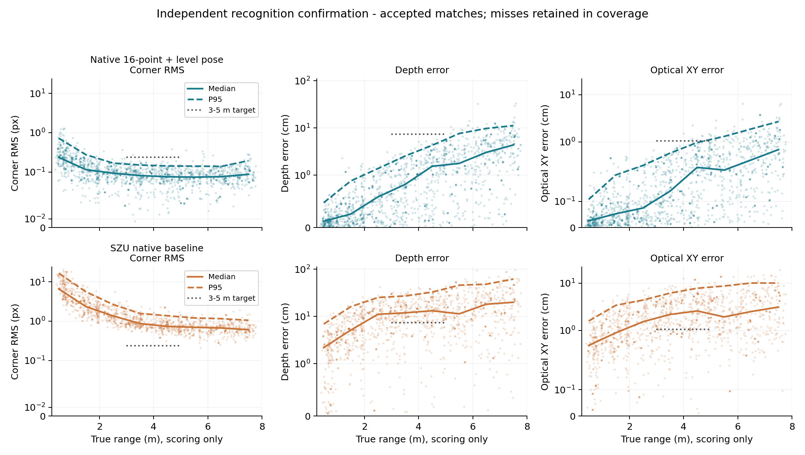

# v0.3 独立识别确认

这是单帧识别评测记录，未据此宣布未来预测达标。候选、两灯证据规则、数字共识、重复抑制和依赖SHA在采集前冻结。确认seed2027102212，384个配置、1536帧；原生1440×1080。先保存并哈希封存所有图像＋相机输入产生的预测，之后才关联目标真值评分。精确角点PnP控制最大0.0839mm，验证标注/坐标链。

## 主要3–5m结果

| 模型 | 有效 / 应评 | 角点 P95 / px | 深度 P95 / cm | 横向 P95 / cm |
| --- | --- | --- | --- | --- |
| 深大原始模型（原生裁块） | 400/423 | 1.502 | 31.03 | 7.268 |
| 深大＋旧尺度校正 | 400/423 | 1.502 | 29.97 | 7.053 |
| 上一轮四点整板网络 | 419/423 | 0.389 | 9.30 | 2.036 |
| 新16点联合精定位 | 422/423 | 0.148 | 3.57 | 0.835 |

角点指标为每块板8个坐标分量的RMS，再对板统计分位数；深度为光学Z绝对误差；横向为光学XY误差范数。距离分桶采用相机到物理装甲中心欧氏距离。模型拒识和未匹配对象都保留在应评分母，角点/米制误差统计有效匹配，必须和覆盖率一起读。

| 新模型3–5m | 均值 | 中位数 | P95 |
| --- | --- | --- | --- |
| 角点 / px | 0.0848 | 0.0780 | 0.1475 |
| 深度 / cm | 1.3766 | 1.0381 | 3.5711 |
| 横向 / cm | 0.2895 | 0.1860 | 0.8346 |

在新模型与深大共同有效的399个对象、101个会话上，整会话500次bootstrap的三项P95差异区间均低于0；不是仅比较不同成功子集得出的收益。完整差异与区间见[evaluation/number3-glyph-v3/paired-primary.json](evaluation/number3-glyph-v3/paired-primary.json)。

按完整会话对全部应评对象进行2000次重采样，3–5m三个P95的95%区间分别为角点[0.1396,0.1675]px、深度[3.375,4.040]cm、横向[0.743,0.958]cm，均低于本次预先指定的绝对精度目标。有效率的区间为[99.265%,100%]，下界没有超过旧报告812/817的覆盖参考；因此只说本次实际覆盖422/423通过，不把它写成未来覆盖保证。[完整重采样结果](evaluation/number3-glyph-v3/absolute-uncertainty.json)。

## 新模型分距离

| 实际距离桶 / m | 有效 / 应评 | 角点 P95 / px | 深度 P95 / cm | 横向 P95 / cm |
| --- | --- | --- | --- | --- |
| 0.3–1 | 213/228 | 0.723 | 0.476 | 0.107 |
| 1–2 | 263/264 | 0.276 | 0.891 | 0.201 |
| 2–3 | 183/184 | 0.169 | 1.381 | 0.319 |
| 3–4 | 211/211 | 0.151 | 2.545 | 0.581 |
| 4–5 | 211/212 | 0.142 | 4.294 | 0.973 |
| 5–6 | 167/167 | 0.141 | 7.654 | 1.311 |
| 6–7 | 174/174 | 0.139 | 9.787 | 1.890 |
| 7–8 | 127/127 | 0.194 | 11.256 | 2.699 |

应评对象实际0.373–7.766m，未把设计范围0.3–8m误称为两端点均已测到。1m内15个未有效输出占全范围18个失败中的大部分；近距像素误差较大但米制误差较小，覆盖仍需改进。远距深度尾部增长，因此没有要求或宣布8m达到3–5m的同一深度目标。

1m内按相机与物理装甲中心的绝对高差分层：0–15cm为117/117，15–30cm为68/75，30–40cm为28/36。15个近距失败均来自更大高差的组合，常见小高差条件覆盖较好；这是分层关联，不能据此断言高差是唯一原因。

## 3–5m分场景

| 场景 | 有效 / 应评 | 角点 P95 / px | 深度 P95 / cm | 横向 P95 / cm |
| --- | --- | --- | --- | --- |
| dark | 133/133 | 0.168 | 3.459 | 0.760 |
| normal | 149/150 | 0.142 | 3.312 | 0.673 |
| bright | 140/140 | 0.131 | 4.045 | 0.952 |
| stationary | 96/96 | 0.142 | 2.728 | 0.743 |
| linear | 109/109 | 0.164 | 3.654 | 0.737 |
| spin | 104/105 | 0.144 | 3.482 | 0.778 |
| combined | 113/113 | 0.150 | 4.535 | 1.003 |
| 高差0–15cm | 207/208 | 0.132 | 3.414 | 0.833 |
| 高差15–30cm | 120/120 | 0.142 | 3.902 | 0.923 |
| 高差30–40cm | 95/95 | 0.169 | 4.025 | 0.806 |

这里的运动标签只描述采集帧所在场景，表内仍是单帧识别误差，不能把combined这一行当作组合运动未来预测结果。场景均衡采样是压力矩阵，不等同真实比赛的出现频率分布。

## 散点和机器可读结果

散点包含全部有效匹配，实线为距离桶中位数、虚线为P95，灰色目标线仅画在3–5m；共享纵轴采用symlog以保留全部尾部。失败不画成零误差，覆盖率另列。

- [完整结果JSON](evaluation/number3-glyph-v3/result.json)
- [逐对象评分JSONL](evaluation/number3-glyph-v3/records.jsonl)
- [全部方法分距离CSV](evaluation/number3-glyph-v3/by-distance.csv)
- [同对象整会话bootstrap](evaluation/number3-glyph-v3/paired-primary.json)

## 解释边界

模型直接测量4个物理灯条端点和12个3号数字顶点，最终姿态还使用同曝光相机姿态、水平车体及固定15°安装角。这些条件和固定印刷几何是方法的一部分；收益不能全部归于原始四点头。四点/16点及有无水平约束的DEV对照支持新增数字几何的作用，未使用逐像素渲染搜索作在线预测。

两灯支持规则是图像证据代理，不是精确遮挡真值。不可见、单灯或极端斜视允许拒识；未知标注范围内的额外输出不自动计为已确认误报。在两套DEV中，数字共识与尺寸重复抑制将排除已知其他目标后的未归属额外输出324/132降为3/2，保留全部3–5m有效输出；全范围分别多漏14/4。仍有极端侧视窄板误输出，不能声称零误检。

深大采用历史0526冻结权重、九个原生640裁块、阈值0.5与相同标定；旧尺度校正系数1.04221015588693固定沿用，没有在本测试集重新拟合。对照哈希见公开provenance记录；深大权重不在此重新分发。

未优化T4全图参考链：新模型中位252.40ms/P95 438.81ms，深大中位62.61ms/P95 72.75ms。该计时包含粗检、精定位与后处理，未包含采集/解码/排队；既不是TensorRT结果，也不是NX验收。当前精度优先阶段通过，10ms要求尚未通过，真实相机和真实模糊未验证。
