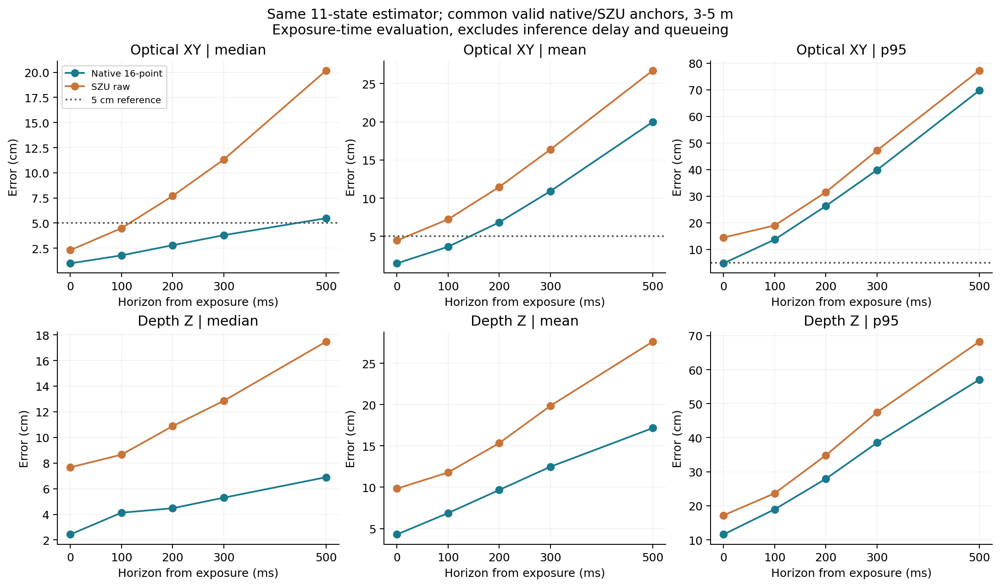
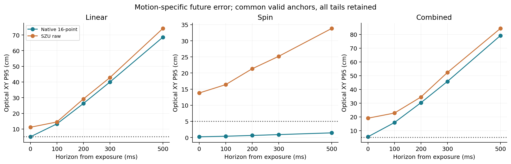
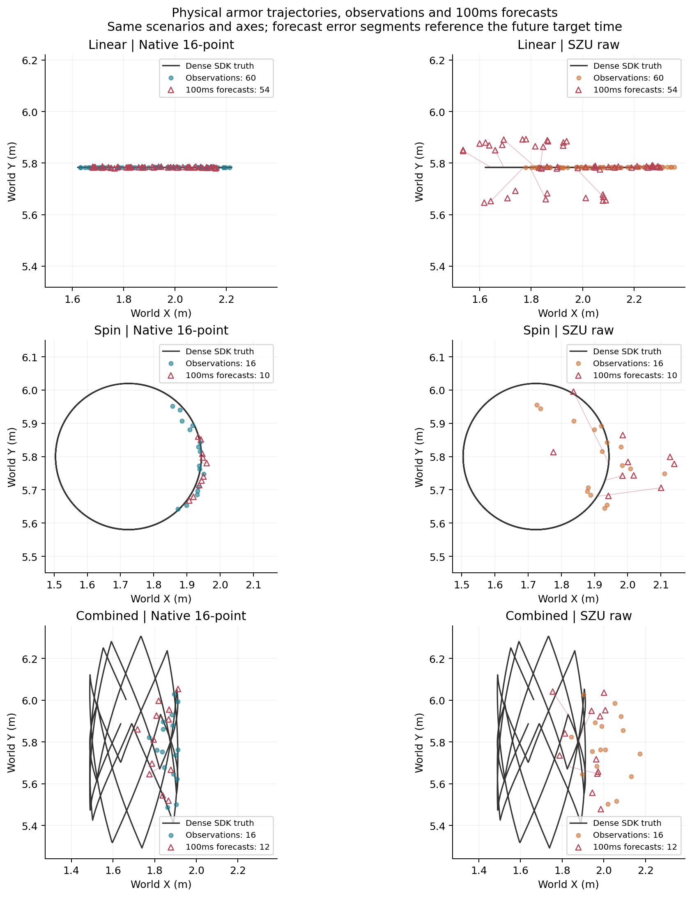
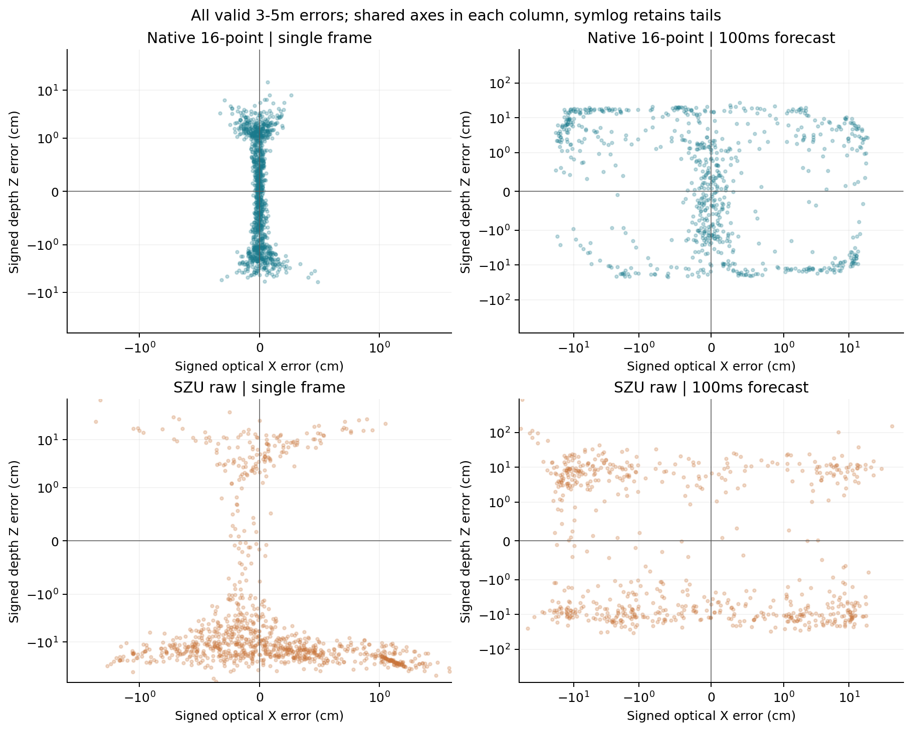

# v0.3 连续运动与未来位置评测

识别独立确认通过后，固定同一识别候选和同一既有11维EKF，再新采72段连续序列、4320帧。纯自转在本次3–5m的100–500ms横向P95均低于5cm；平移和组合运动没有通过。没有用此确认集调整权重、阈值或预测器。

原生1440×1080，8距离段×3光照×3运动；水平车体、固定15°装甲安装、相机无roll，高差±40cm。各会话图像间隔中位数162–278ms，属于稀疏观测；独立SDK真值更密，4320帧均精确关联，只允许≤25ms真值间隙内插值。运动含频繁往返换向，不等同于长时间匀速直线运动。

## 连续序列中的单帧识别（3–5m）

| 模型 | 有效/应评 | 角点P95 px | 深度P95 cm | 横向P95 cm |
| --- | --- | --- | --- | --- |
| 新16点模型 | 1167/1169 | 0.155 | 3.385 | 0.160 |
| 原报告模型 | 843/1169 | 29.614 | 312.405 | 11.984 |
| 深大原始 | 1030/1169 | 1.530 | 29.595 | 1.555 |
| 深大＋旧尺度 | 1030/1169 | 1.530 | 25.803 | 1.131 |

这是新连续序列上的复核；其相机朝向和样本分布与独立识别矩阵不同，不能用较小的时序单帧横向数字替换主识别验收。主验收仍见[EVALUATION_GLYPH.md](EVALUATION_GLYPH.md)。

## 同一预测器，曝光时刻起算

以下为每个方法全部有效的应评预测，误差为发出时刻光学XY平面范数；拒识/跟踪失败仍保留在分母。零时域是滤波状态误差，不是单帧识别误差。每段预热1秒，离线只用当前真值选择一个物理板身份并在未来保持该身份；真值不改变预测状态。这是未来位置研究评测，不包含在线目标选择或设备控制。

| 时域 ms | 新模型有效/应评 | 新模型中位 cm | 新模型均值 cm | 新模型P95 cm | 深大有效/应评 | 深大P95 cm |
| --- | --- | --- | --- | --- | --- | --- |
| 0 | 742/744 | 1.074 | 1.568 | 5.055 | 682/744 | 14.465 |
| 100 | 741/743 | 2.018 | 3.978 | 14.578 | 681/743 | 19.014 |
| 200 | 742/744 | 3.194 | 7.592 | 27.432 | 682/744 | 31.511 |
| 300 | 741/743 | 4.414 | 12.134 | 41.799 | 681/743 | 47.146 |
| 500 | 742/744 | 6.788 | 22.399 | 74.150 | 682/744 | 77.282 |

| 运动 | 100ms：新/深大 P95 cm | 200ms：新/深大 | 300ms：新/深大 | 500ms：新/深大 |
| --- | --- | --- | --- | --- |
| 平移 | 13.260 / 14.485 | 26.256 / 29.171 | 39.947 / 42.788 | 68.574 / 74.135 |
| 纯自转 | 0.383 / 16.396 | 0.623 / 21.316 | 0.892 / 25.179 | 1.427 / 33.825 |
| 组合 | 15.820 / 22.761 | 30.288 / 34.422 | 45.781 / 52.304 | 79.176 / 84.363 |

分运动表和下图使用新模型与深大共同有效的同一锚点，便于比较观测收益；因此与上一表各自覆盖总体的分位数略有不同。共同子集不能替代覆盖率验收。全部方法、分距离/光照/高差和匹配数见机器可读结果。

## 误差来源诊断

作为离线控制，使用真实当前车体位置、速度、角速度和装甲偏移，仍按匀速/匀角速度外推，不读取未来状态作为预测输入。在新/深大共同锚点上，100ms横向P95为平移5.03cm、组合6.98cm；500ms分别63.59cm、70.41cm。即便当前状态完全正确，匀速外推跨过换向也会有明显误差。这是所选运动模型的诊断，不是所有因果预测器的理论下界，也不是可部署结果。

误差不全由未来换向解释：限定过去250ms至未来100ms均未发生速度反转的诊断子集，新模型接入现有EKF后的P95仍为平移7.67cm、组合7.47cm，而真值当前状态控制接近零。这支持继续检查速度/关联/状态响应；这些子集只用于归因，不从正式指标中删除换向样本。当前没有证据支持继续盲目增加识别数据就能解决全部未来误差。

## 实际计算延迟的影响

本连续序列T4参考链中位241.23ms（粗检37.90ms，精定位与几何203.17ms），深大中位66.48ms。计入逐帧实测计算时长、再从可用时刻预测100ms，新模型混合运动总体横向P95为53.57cm，深大27.14cm。这里仅延长外推时间，没有模拟吞吐和排队，不是实时闭环验收。当前速度会抵消部分精度收益，10ms部署目标仍未通过。

## 轨迹与散点

固定选正常光照、3.5m场景，每种运动展示同一物理板；按覆盖选板而不按误差挑案例。黑线为稠密真值，圆点为观测，三角为100ms未来点。左右同场景同轴，红色细线连接部分预测与其未来时刻真值。

- [摘要JSON](evaluation/number3-glyph-v3-temporal/summary.json)
- [全部原始统计JSON（gzip）](evaluation/number3-glyph-v3-temporal/result.json.gz)
- [分距离及各时域CSV](evaluation/number3-glyph-v3-temporal/future-by-distance.csv)
- [同锚点配对统计](evaluation/number3-glyph-v3-temporal/common-native-szu.json)
- [真值当前状态离线诊断](evaluation/number3-glyph-v3-temporal/exact-current-state-diagnostic.json)
- [采样、封存与校验记录](evaluation/number3-glyph-v3-temporal/provenance.json)

未验证真实相机、真实曝光模糊、其他编号、Jetson NX或TensorRT/INT8。预测提升不能直接换算为命中率；本次没有生成PDF。
