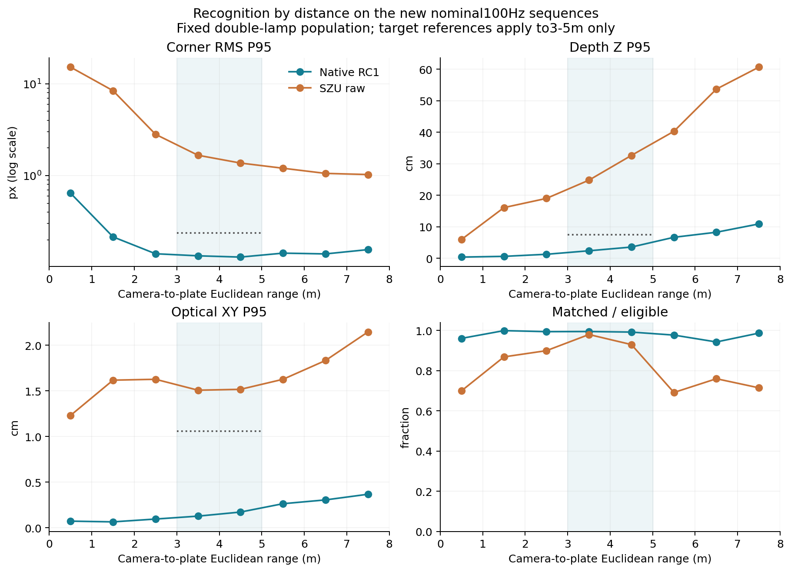
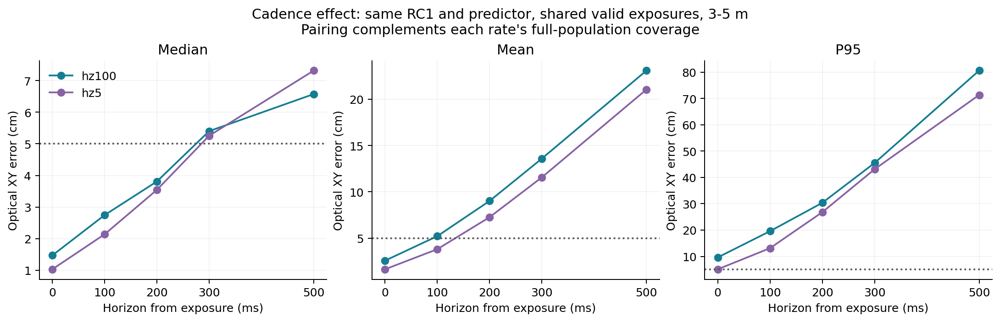
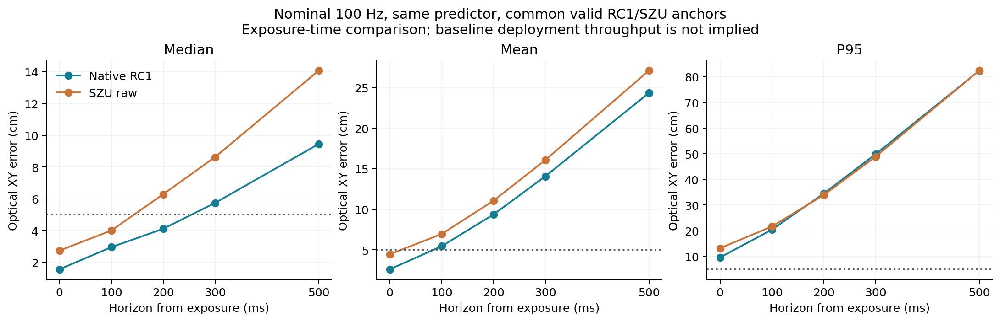
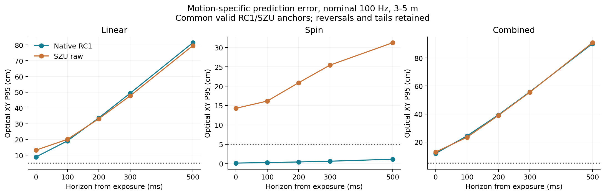
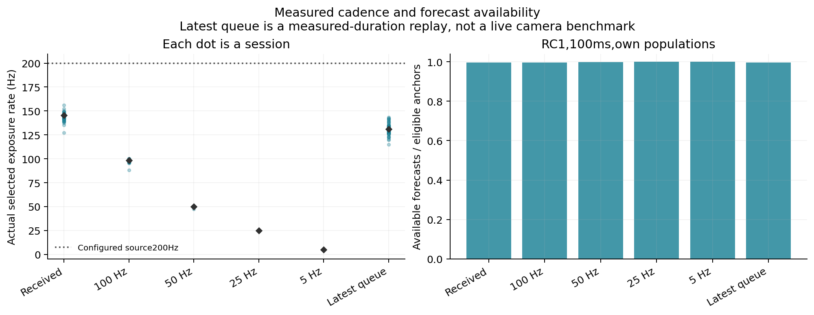
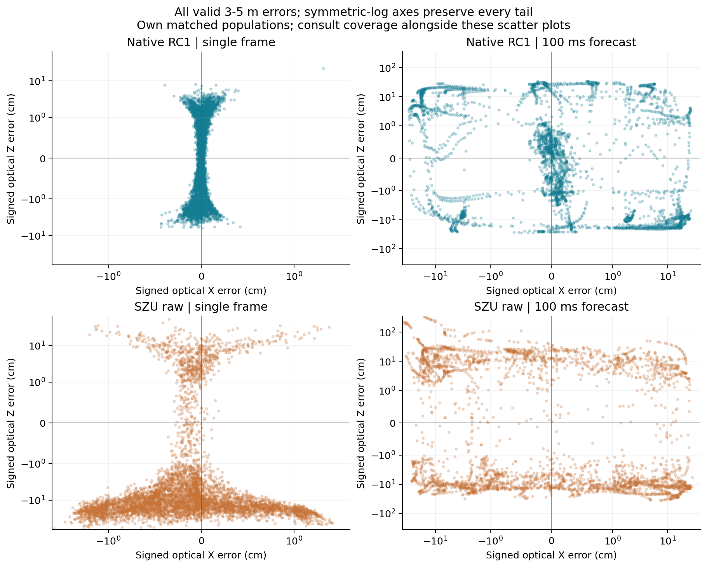
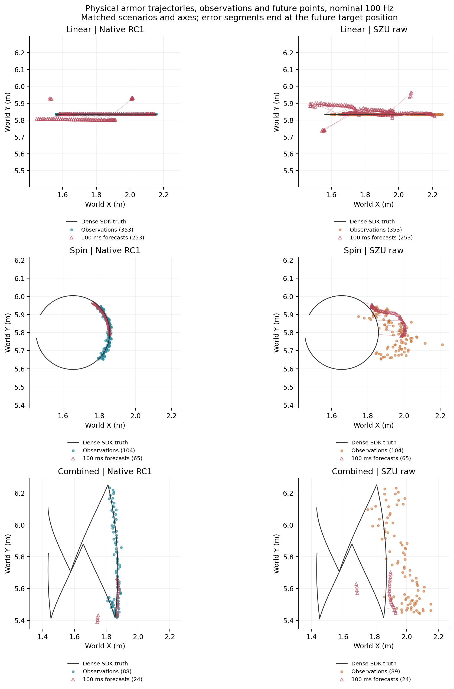

# 高帧率重新采集与预测小改版

新采72会话、36,864帧原生1440×1080图像，覆盖三运动、三光照、八距离段。车体roll/pitch=0、相机roll≈0，高差实测−33.4至+36.6cm，装甲固定15°安装角。按固定双灯条可见规则评分，分母不随模型拒识改变。源配置上限200Hz，实际分段曝光中位145.278Hz（127.211–156.211）；100Hz视图实际中位98.467Hz。

收到帧视图3–5m单帧结果：

|方法|有效/应评|角点RMS P95 px|深度P95 cm|横向P95 cm|
|---|---:|---:|---:|---:|
|当前原生模型|9685/9739|0.1317|3.072|0.150|
|深大原始|9293/9739|1.5238|29.201|1.510|
|深大＋旧尺度校正|9293/9739|1.5238|24.360|1.083|

当前模型均值/中位数/P95：角点0.07778/0.07453/0.13171px；深度1.204/0.986/3.072cm；横向0.0522/0.0360/0.1500cm。这是同一冻结模型在新数据上的表现，不是重新训练增益，也不是与旧静态报告同一总体。3–5m绝对识别目标通过；0–1m角点P95约0.648px、6–7m覆盖94.13%的弱项仍保留。

## 时间口径

T4识别计算均值7.391ms、中位7.481ms、P95 8.971ms；含H2D、预处理、网络、几何与拒识，不含相机传输/PNG解码/外部队列。

实际墙钟latest测试预载1536帧原生RGB，处理1441帧、替换95帧。平移/自转/组合输出140.0/132.4/132.8Hz；计算加排队结果年龄P95为12.68/14.10/13.43ms；组合段最大91.74ms保留。没有物理相机/传输/解码，预测器随后离线回放，不是完整实时预测链或Orin NX测速。

## 原冻结EKF的帧率与模型对照

下面七张图使用原冻结EKF，不是R修正版。100Hz总体100ms横向P95为20.65cm；同曝光173个共同锚点的100Hz/5Hz P95为19.57/13.11cm。只支持旧估计器未有效利用高频观测，不支持低帧率普遍更好。完整覆盖率及共同锚点数量保留在JSON。

## 本次采用的小改动

[预测模块](../prediction/README.md)保持11D状态/Q/关联不变，只修正R。另一组六段DEV、3072帧，3.5/4.5m×三运动、normal光照验证：100ms横向P95为平移6.91cm、自转0.24cm、组合8.47cm。均值、中位数、P95/P99和0–500ms各时域见[prediction-v1/summary.json](../evaluations/prediction-v1/summary.json)。

离线诊断中远离换向的100ms P95为平移0.389cm、组合0.324cm；正式总指标仍包含所有换向。近期换向速度响应、未来跨换向模型失配仍是尾部来源。简单板跟踪及局部拟合仅作DEV对照；本版未采用换向触发机制。用户接受当前效果后交付，不将原全运动5cm目标改写为通过。

received-summary.json、hz100-summary.json保留分距离/光照/高差/俯仰/朝向及深大统计；paired-rate-results.json是同曝光帧率对照；wall-queue.json是真实墙钟队列。prediction-v1/package-validation.json记录独立构建、逐字回放和流式验证。

原生图像、真值和全部保护资产保留服务器；无本地全量备份、无新PDF。真实相机、物理模糊、其他编号和Orin NX尚未验收。
